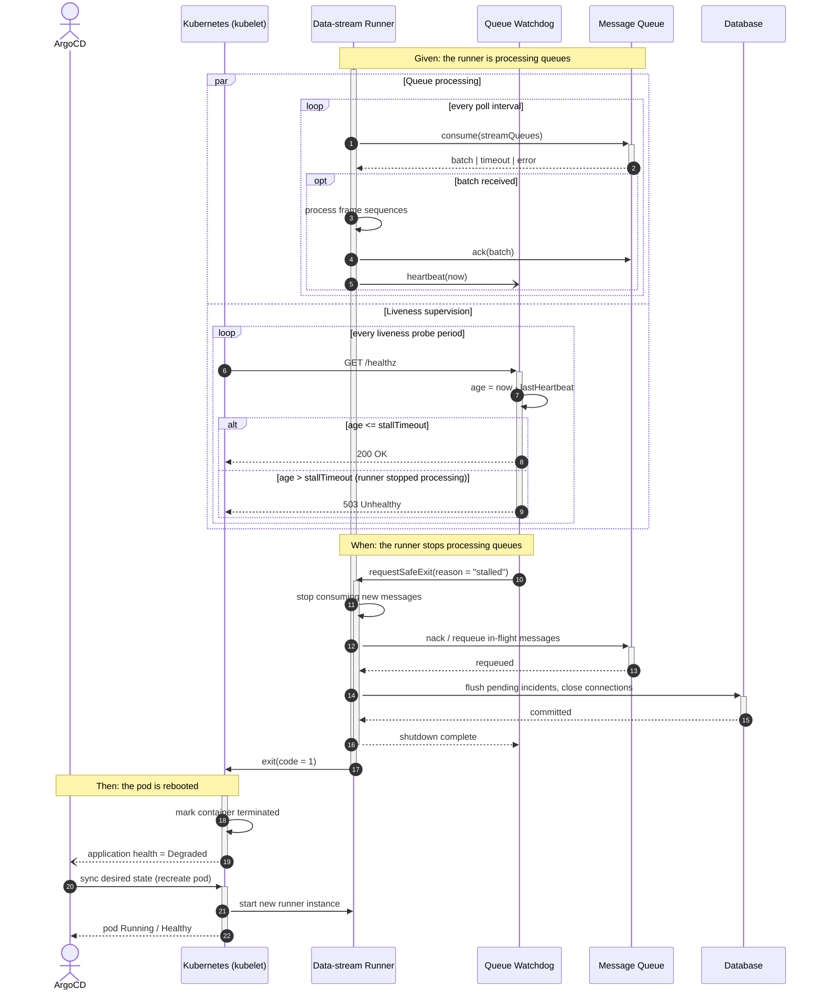
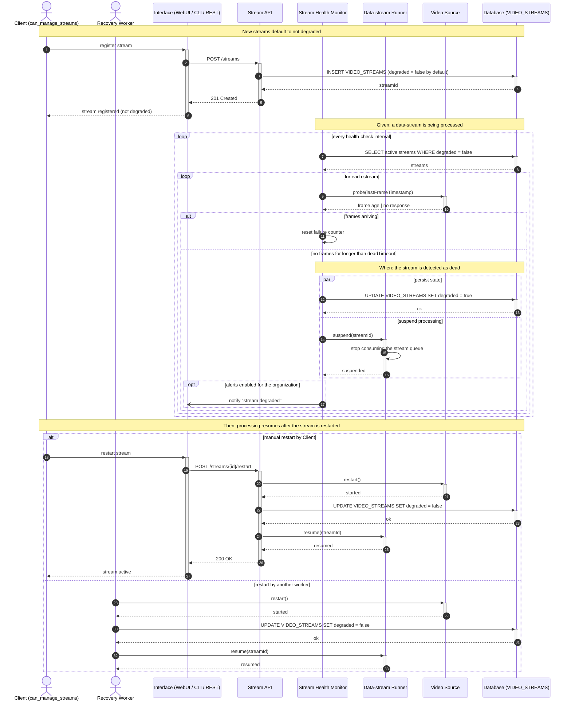
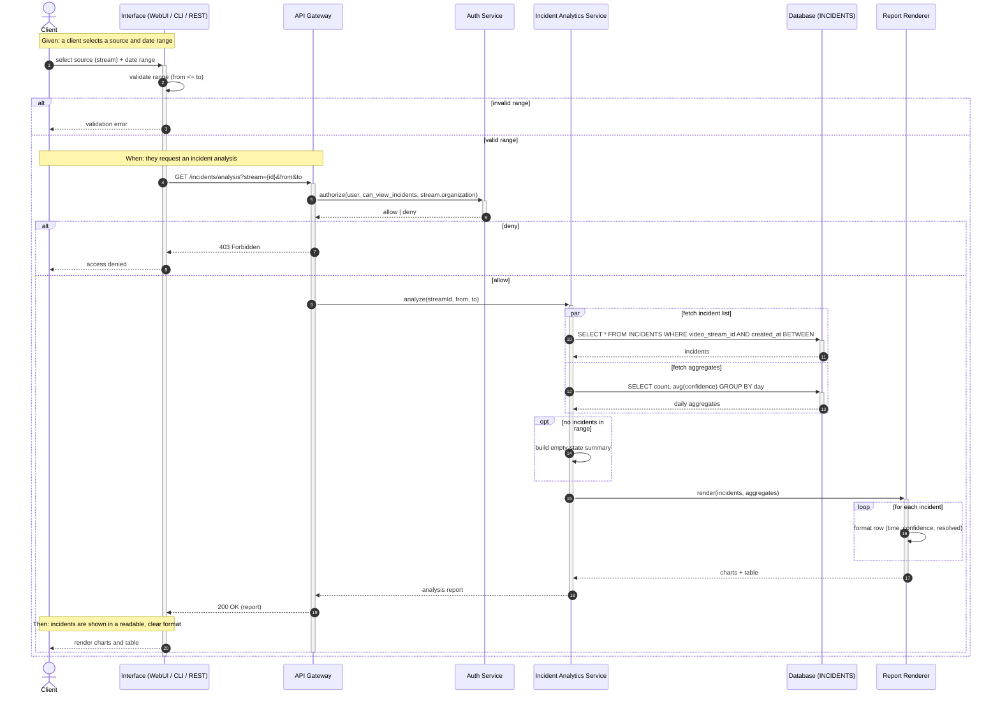
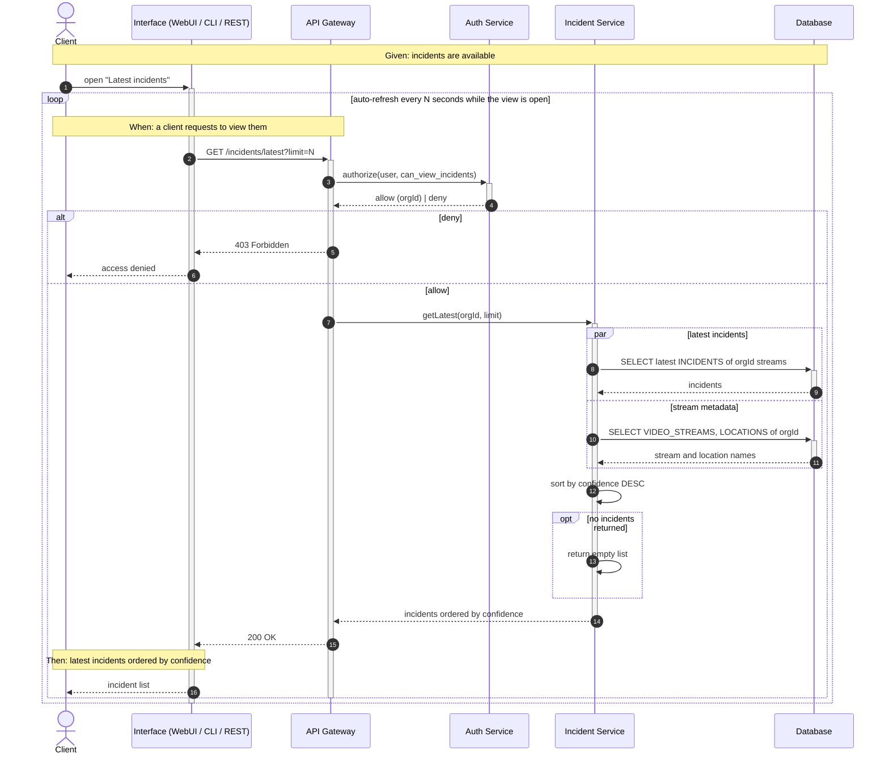
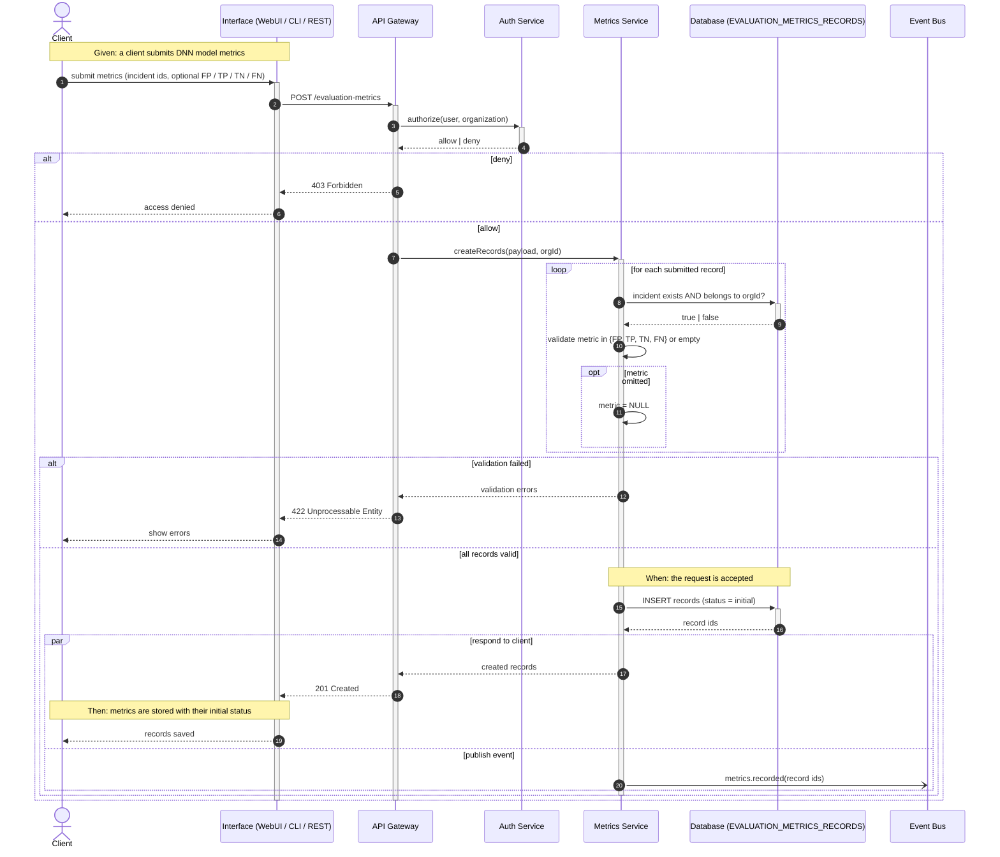
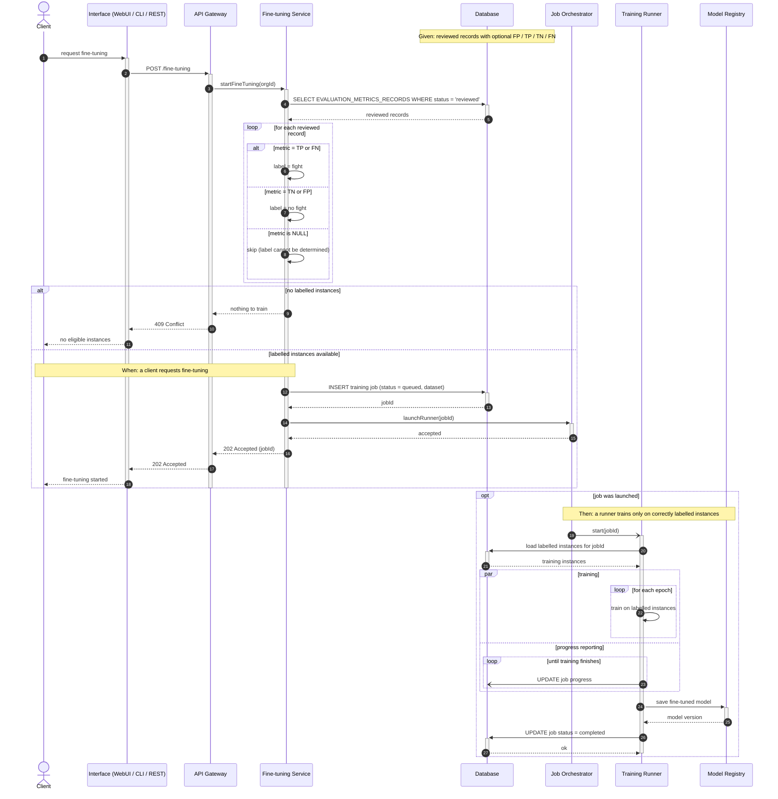
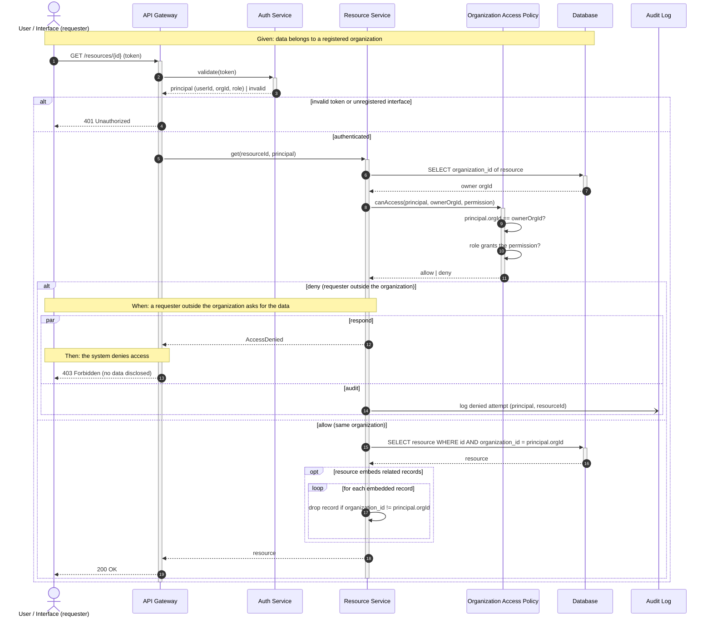

# Sequence Diagrams

Sequence diagrams for every use case in [Gherkin.md](./Gherkin.md).

**Notation**
- `actor`: a human or external system that starts or watches the flow
- `participant`: a system component or object
- `->>`: synchronous call; `-)`: asynchronous message; `-->>`: return
- Activation bars: `+` / `-` on a message, or `activate` / `deactivate`
- Combined fragments: `opt`, `alt`/`else`, `loop`, `par`/`and`

**Fragment coverage**

| UC | Actors | opt | alt | loop | par |
| :--- | :--- | :---: | :---: | :---: | :---: |
| UC-01.1 | ArgoCD | ✓ | ✓ | ✓ | ✓ |
| UC-01.2 | Client, Recovery Worker | ✓ | ✓ | ✓ | ✓ |
| UC-02.1 | Client | ✓ | ✓ | ✓ | ✓ |
| UC-02.2 | Client | ✓ | ✓ | ✓ | ✓ |
| UC-03.1 | Client | ✓ | ✓ | ✓ | ✓ |
| UC-03.2 | Client | ✓ | ✓ | ✓ | ✓ |
| UC-04.1 | User / Interface | ✓ | ✓ | ✓ | ✓ |

---

## Feature 01: Data-stream health

### UC-01.1: Exit safely when a runner stops (US-01, REQ-01)

### UC-01.2: Isolate and recover a dead data-stream (US-02, REQ-02)

---

## Feature 02: Incident review

### UC-02.1: Analyze incidents by source and date range (US-03, REQ-03)

### UC-02.2: Review the latest incidents (US-04, REQ-07)

---

## Feature 03: DNN metrics and fine-tuning

### UC-03.1: Record model metrics (US-05, REQ-04)

### UC-03.2: Fine-tune from reviewed evaluation metrics (US-06, REQ-05)

---

## Feature 04: Organization data privacy

### UC-04.1: Restrict access to organization-owned data (US-07, REQ-06)

